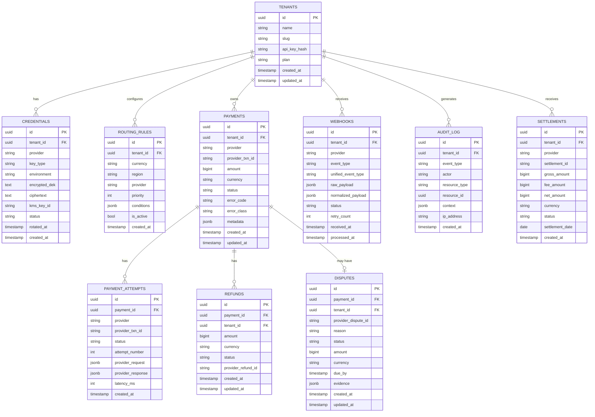

And the raw Mermaid if you want to paste it into docs or Notion:

A few design decisions worth calling out:

`PAYMENTS` vs `PAYMENT_ATTEMPTS` is the most important split. A single payment can have multiple attempts — first try fails on Stripe, auto-retried on Razorpay. The `PAYMENTS` table holds the canonical outcome; `PAYMENT_ATTEMPTS` holds every provider call with the raw request/response for debugging and reconciliation. Never collapse these into one table.

`amount` is stored as `bigint` in the smallest currency unit (paise, cents) — never a float. Floating point money is a class of bugs you never want to debug in production.

`WEBHOOKS` stores both `raw_payload` and `normalized_payload` — the raw because you need it for signature verification and audit; the normalized because downstream services should never have to re-parse provider-specific formats.

`CREDENTIALS` never stores plaintext — only `encrypted_dek` and `ciphertext` as discussed in the vault architecture. The `kms_key_id` field lets you track which KMS key version was used for each row, enabling key rotation without a big-bang re-encryption.

`AUDIT_LOG` should be in a separate Postgres instance with no `DELETE` or `UPDATE` grants — append-only enforced at the infrastructure level, not just application logic.

Want the indexes and partitioning strategy for this schema next, or the API spec?