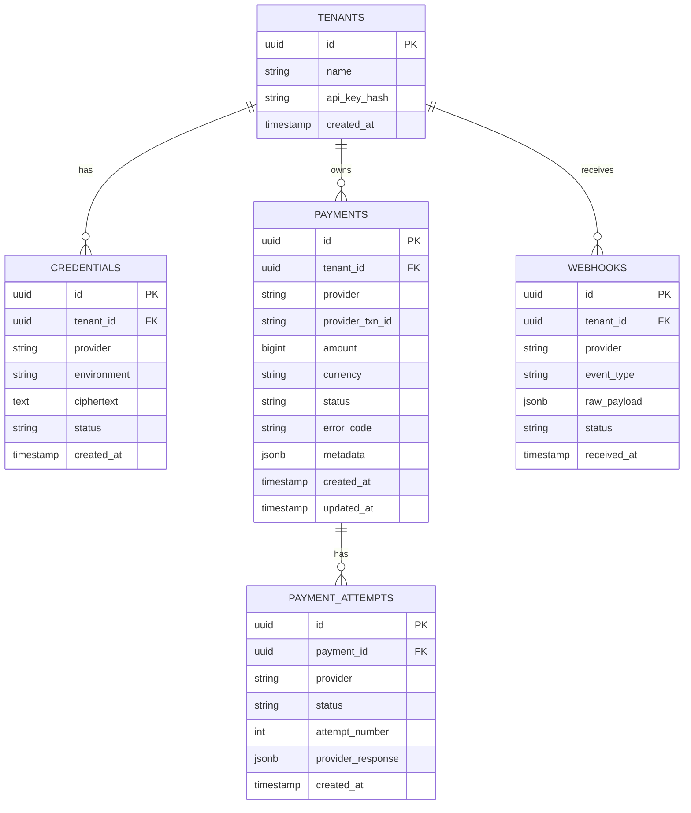

Here's a lean MVP — only what you need to get first clients live and charging.One service, one database, three connectors. No Kafka, no Redis, no microservices. Now the schema:5 tables. That's the whole MVP data model. Here's the raw Mermaid:

What's cut from the full design and why:

`ROUTING_RULES` — hardcode currency → provider in config for now. You don't need a DB-driven rule engine until you have clients with conflicting routing needs. `REFUNDS` — store refunds as a `metadata` field on `PAYMENTS` with `status: refunded` until a client actually asks for refund history. `DISPUTES` — handle manually via provider dashboards for your first 10 clients. `SETTLEMENTS` — query provider APIs directly for now; build reconciliation once you have clients asking "where's my money." `AUDIT_LOG` — Postgres's built-in `created_at` timestamps cover you for MVP; a separate audit table comes with your first enterprise client.

The one thing not to cut even at MVP: `PAYMENT_ATTEMPTS`. The moment you have retry/failover logic, you need this table or debugging failed payments becomes impossible.

For the credential vault at MVP — use AES-256-GCM with a master key in an environment variable (not hardcoded). It's not as robust as KMS but it's good enough to launch. Migrate to KMS before your first client who asks about your security posture.

Stack recommendation for MVP: Node.js (Fastify) or Python (FastAPI), Postgres on Railway or Supabase, deploy on Railway or Render. You can be live in under a week.