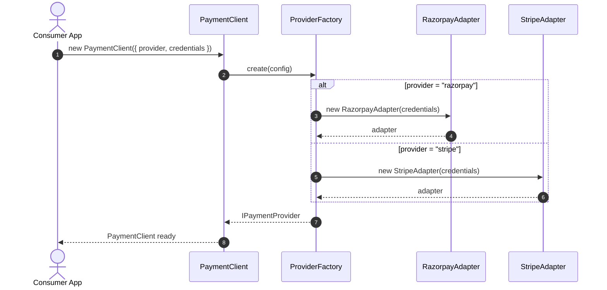
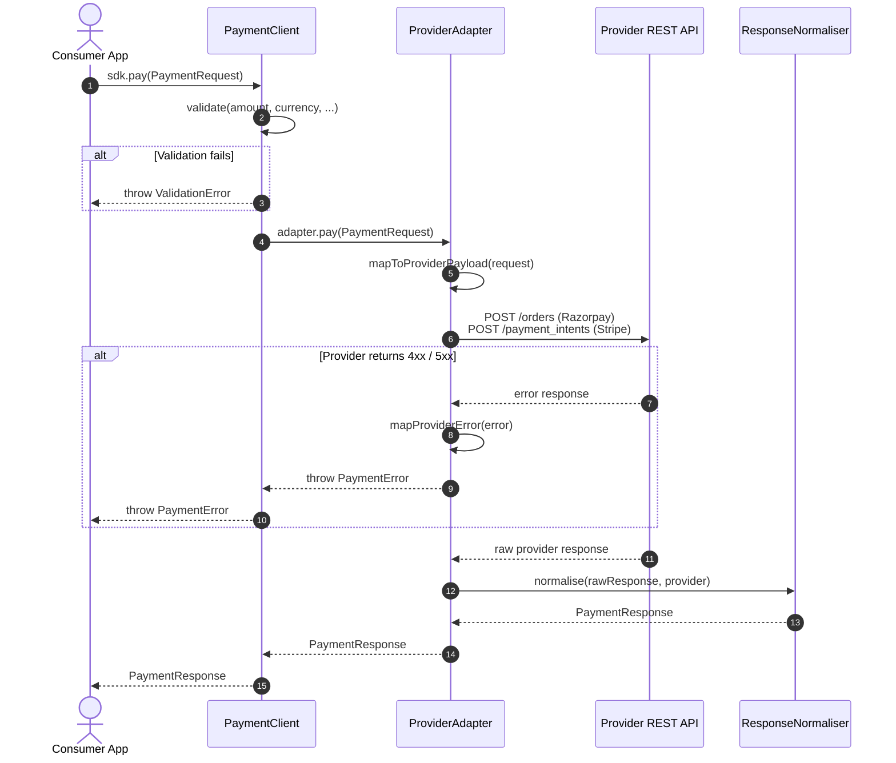
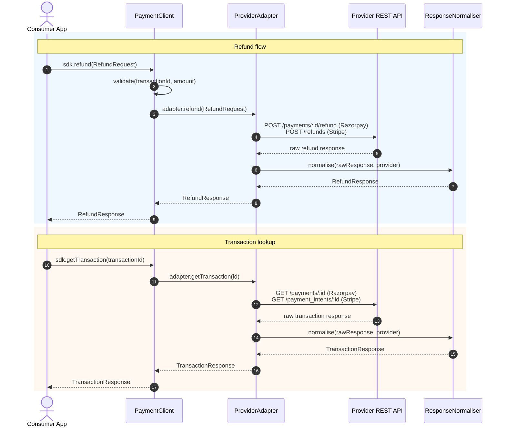
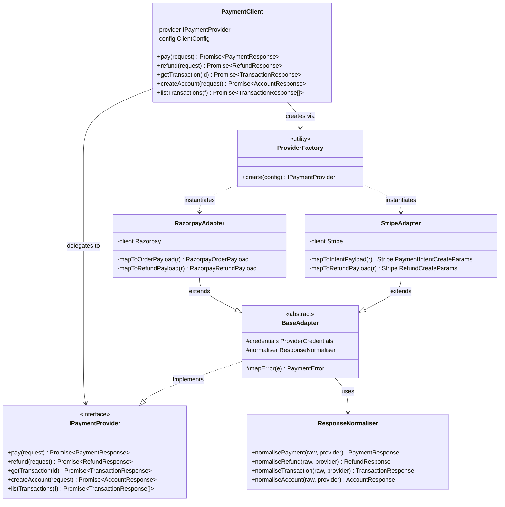
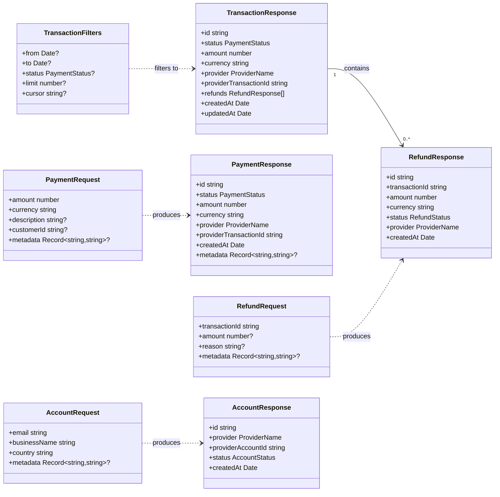
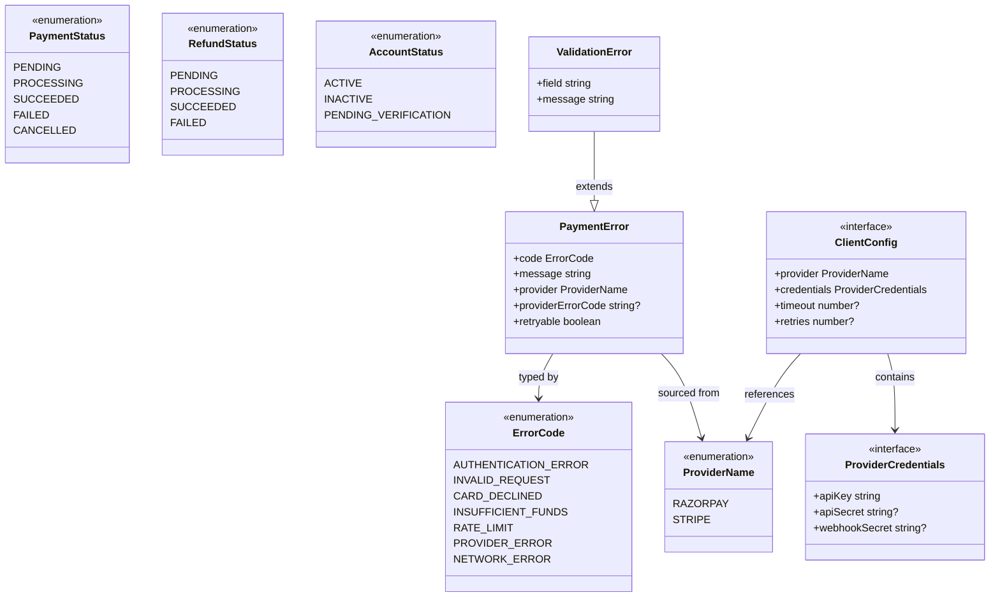

# Payment SDK — MVP Design Document

> **Type:** Internal SDK · **Language:** TypeScript · **Providers:** Razorpay, Stripe  
> **Status:** MVP Design · **Version:** 0.1.0

---

## Table of Contents

1. [Overview](#overview)
2. [Goals & Non-Goals](#goals--non-goals)
3. [Architecture Overview](#architecture-overview)
4. [System Sequence Diagram](#system-sequence-diagram)
5. [UML — Core Package Class Diagram](#uml--core-package-class-diagram)
6. [Project Structure](#project-structure)
7. [Core Abstractions](#core-abstractions)
8. [Provider Implementations](#provider-implementations)
9. [Public SDK API](#public-sdk-api)
10. [Configuration](#configuration)
11. [Error Handling](#error-handling)

---

## Overview

The **Payment SDK** is an internal TypeScript library that abstracts away the differences between payment providers (Razorpay, Stripe) behind a single, unified API. Consumers configure a provider once at startup and call provider-agnostic methods — `pay()`, `refund()`, `getTransaction()`, `createAccount()` — without knowing which underlying SDK is being called.

```
Consumer App
    │
    ▼
@internal/payment-sdk
    ├── pay()
    ├── refund()
    ├── getTransaction()
    └── createAccount()
         │
         ├── RazorpayAdapter  ──▶  Razorpay API
         └── StripeAdapter    ──▶  Stripe API
```

---

## Goals & Non-Goals

### Goals (MVP)

- Provide a single `PaymentClient` class that wraps Razorpay and Stripe.
- Implement a **provider-agnostic interface** for: payments, refunds, transaction lookup, and account management.
- Support **runtime provider switching** via configuration (no code changes needed to swap providers).
- Normalise responses from both providers into a **unified response shape**.
- Centralised, typed error handling across all providers.
- Full TypeScript — no `any` types in the public API.

### Non-Goals (MVP)

- UI widgets or embedded checkout flows.
- Webhook signature verification (post-MVP).
- Database persistence of transactions.
- Multi-provider fan-out (calling both providers simultaneously).
- PCI-DSS compliance tooling.

---

## Architecture Overview

The SDK follows a **Strategy + Adapter pattern**:

- `PaymentClient` is the facade consumers use.
- `IPaymentProvider` is the strategy interface every adapter must implement.
- `RazorpayAdapter` and `StripeAdapter` are concrete adapters that translate the common interface into provider-specific API calls and normalise responses back.

```
┌──────────────────────────────────────────────────────────────────┐
│                         Consumer Application                      │
└───────────────────────────────┬──────────────────────────────────┘
                                │  new PaymentClient({ provider: 'stripe' })
                                ▼
┌──────────────────────────────────────────────────────────────────┐
│                         PaymentClient                             │
│   pay()  refund()  getTransaction()  createAccount()             │
└───────────────────────────────┬──────────────────────────────────┘
                                │  this.provider.pay(...)
                                ▼
┌──────────────────────────────────────────────────────────────────┐
│                      IPaymentProvider (interface)                 │
│   pay()  refund()  getTransaction()  createAccount()             │
└───────────┬──────────────────────────────────────┬───────────────┘
            │                                      │
            ▼                                      ▼
┌───────────────────────┐              ┌───────────────────────────┐
│   RazorpayAdapter     │              │      StripeAdapter        │
│ ─────────────────     │              │ ─────────────────────     │
│ razorpay.orders       │              │ stripe.paymentIntents     │
│ razorpay.refunds      │              │ stripe.refunds            │
│ razorpay.payments     │              │ stripe.charges            │
│ razorpay.accounts     │              │ stripe.accounts           │
└───────────┬───────────┘              └──────────────┬────────────┘
            │                                         │
            ▼                                         ▼
    Razorpay REST API                         Stripe REST API
```

---

## System Sequence Diagrams

Three focused diagrams, one per flow. Each stands alone — follow any one without reading the others.

---

### Diagram 1 — Initialisation

> How the client is wired up and which adapter is selected.



---

### Diagram 2 — Payment flow

> Full lifecycle of a `pay()` call, including validation and error paths.



---

### Diagram 3 — Refund & transaction lookup

> How refunds are issued and how a past transaction is retrieved.



---

## UML — Core Package Class Diagrams

Three focused diagrams, each covering one concern. Reading them left-to-right gives the full picture.

---

### Diagram 1 — Client & adapter hierarchy

> How `PaymentClient` connects to providers, and how adapters are structured.



---

### Diagram 2 — Request & response types

> The data shapes flowing in and out of the public API.



---

### Diagram 3 — Enums & error model

> All status values and the typed error hierarchy.



---

## Project Structure

```
payment-sdk/
├── packages/
│   ├── core/                          # @payment-sdk/core
│   │   ├── src/
│   │   │   ├── index.ts               # Public entry point
│   │   │   ├── client.ts              # PaymentClient (facade)
│   │   │   ├── factory.ts             # ProviderFactory
│   │   │   ├── normaliser.ts          # ResponseNormaliser
│   │   │   ├── adapters/
│   │   │   │   ├── base.ts            # BaseAdapter (abstract)
│   │   │   │   ├── razorpay.ts        # RazorpayAdapter
│   │   │   │   └── stripe.ts          # StripeAdapter
│   │   │   ├── types/
│   │   │   │   ├── requests.ts        # PaymentRequest, RefundRequest, AccountRequest
│   │   │   │   ├── responses.ts       # PaymentResponse, RefundResponse, etc.
│   │   │   │   ├── config.ts          # ClientConfig, ProviderCredentials
│   │   │   │   └── enums.ts           # PaymentStatus, ProviderName, ErrorCode, etc.
│   │   │   └── errors.ts              # PaymentError hierarchy
│   │   ├── tests/
│   │   │   ├── unit/
│   │   │   │   ├── client.test.ts
│   │   │   │   ├── adapters/
│   │   │   │   │   ├── razorpay.test.ts
│   │   │   │   │   └── stripe.test.ts
│   │   │   │   └── normaliser.test.ts
│   │   │   ├── integration/           # Gated by INTEGRATION=true env var
│   │   │   │   └── payment-flow.test.ts
│   │   │   └── fixtures/              # JSON snapshots of provider API responses
│   │   │       ├── razorpay/
│   │   │       └── stripe/
│   │   ├── package.json
│   │   └── tsconfig.json
├── examples/
│   ├── stripe-payment.ts
│   └── razorpay-payment.ts
├── docs/
│   ├── getting-started.md
│   └── api-reference.md
├── package.json                       # Monorepo root
├── tsconfig.base.json
├── vitest.config.ts
└── tsup.config.ts
```

---

## Core Abstractions

### `IPaymentProvider` interface

Every adapter must implement this interface. It is the single contract the `PaymentClient` depends on.

```typescript
interface IPaymentProvider {
  pay(request: PaymentRequest): Promise<PaymentResponse>;
  refund(request: RefundRequest): Promise<RefundResponse>;
  getTransaction(id: string): Promise<TransactionResponse>;
  createAccount(request: AccountRequest): Promise<AccountResponse>;
  listTransactions(filters: TransactionFilters): Promise<TransactionResponse[]>;
}
```

### `PaymentClient` (facade)

The only class consumers instantiate. It resolves the adapter at construction time and delegates all calls.

```typescript
const sdk = new PaymentClient({
  provider: 'stripe',
  credentials: { apiKey: process.env.STRIPE_KEY! },
});

const payment = await sdk.pay({
  amount: 5000,       // in smallest currency unit (paise / cents)
  currency: 'INR',
  description: 'Order #1234',
});
```

### `ResponseNormaliser`

Translates provider-specific response shapes into the SDK's unified types. Both adapters share a single normaliser instance — it is the only place raw provider objects are touched.

### `ProviderFactory`

Constructs the correct adapter from config. Adding a new provider only requires: creating a new adapter class and registering it here.

```typescript
// factory.ts
export class ProviderFactory {
  static create(config: ClientConfig): IPaymentProvider {
    switch (config.provider) {
      case 'razorpay': return new RazorpayAdapter(config.credentials);
      case 'stripe':   return new StripeAdapter(config.credentials);
      default: throw new Error(`Unknown provider: ${config.provider}`);
    }
  }
}
```

---

## Provider Implementations

### RazorpayAdapter

| SDK method | Razorpay API call |
|---|---|
| `pay()` | `POST /v1/orders` → capture via `POST /v1/payments/:id/capture` |
| `refund()` | `POST /v1/payments/:id/refund` |
| `getTransaction()` | `GET /v1/payments/:id` |
| `createAccount()` | `POST /v2/accounts` (Route) |
| `listTransactions()` | `GET /v1/payments?from=&to=&count=` |

### StripeAdapter

| SDK method | Stripe API call |
|---|---|
| `pay()` | `POST /v1/payment_intents` + confirm |
| `refund()` | `POST /v1/refunds` |
| `getTransaction()` | `GET /v1/payment_intents/:id` |
| `createAccount()` | `POST /v1/accounts` (Connect) |
| `listTransactions()` | `GET /v1/payment_intents?limit=&starting_after=` |

---

## Public SDK API

### `sdk.pay(request)`

```typescript
// Request
interface PaymentRequest {
  amount: number;          // Smallest unit: paise (INR) or cents (USD)
  currency: string;        // ISO 4217 e.g. "INR", "USD"
  description?: string;
  customerId?: string;
  metadata?: Record<string, string>;
}

// Response
interface PaymentResponse {
  id: string;                      // SDK-level transaction ID
  status: PaymentStatus;           // PENDING | PROCESSING | SUCCEEDED | FAILED
  amount: number;
  currency: string;
  provider: ProviderName;
  providerTransactionId: string;   // The raw ID from Razorpay / Stripe
  createdAt: Date;
  metadata?: Record<string, string>;
}
```

### `sdk.refund(request)`

```typescript
interface RefundRequest {
  transactionId: string;   // SDK transaction ID from PaymentResponse
  amount?: number;         // Partial refund if provided; full refund if omitted
  reason?: string;
  metadata?: Record<string, string>;
}
```

### `sdk.getTransaction(id)`

Returns a `TransactionResponse` which includes the payment details plus an array of associated `RefundResponse` objects.

### `sdk.createAccount(request)`

```typescript
interface AccountRequest {
  email: string;
  businessName: string;
  country: string;         // ISO 3166-1 alpha-2 e.g. "IN", "US"
  metadata?: Record<string, string>;
}
```

---

## Configuration

```typescript
const sdk = new PaymentClient({
  provider: 'razorpay',         // 'razorpay' | 'stripe'
  credentials: {
    apiKey: 'rzp_live_xxx',
    apiSecret: 'secret_xxx',    // Required for Razorpay; optional for Stripe
  },
  timeout: 30_000,              // Request timeout in ms (default: 30000)
  retries: 3,                   // Retry attempts on 5xx errors (default: 3)
});
```

Credentials are **never logged** by the SDK and never appear in error messages or stack traces.

---

## Error Handling

All errors thrown by the SDK extend `PaymentError`. Consumers can catch specific error codes.

```typescript
import { PaymentClient, PaymentError, ErrorCode } from '@payment-sdk/core';

try {
  const result = await sdk.pay({ amount: 1000, currency: 'INR' });
} catch (err) {
  if (err instanceof PaymentError) {
    switch (err.code) {
      case ErrorCode.CARD_DECLINED:
        // Handle card decline
        break;
      case ErrorCode.RATE_LIMIT:
        // Retry after delay
        break;
      case ErrorCode.AUTHENTICATION_ERROR:
        // Check API credentials
        break;
    }
    console.log(err.retryable);          // Boolean — safe to retry?
    console.log(err.providerErrorCode);  // Raw provider code e.g. "card_declined"
  }
}
```

### Error codes

| Code | Description | Retryable |
|---|---|---|
| `AUTHENTICATION_ERROR` | Invalid API key or secret | No |
| `INVALID_REQUEST` | Malformed payload or missing required field | No |
| `CARD_DECLINED` | Card declined by issuer | No |
| `INSUFFICIENT_FUNDS` | Card has insufficient balance | No |
| `RATE_LIMIT` | Too many requests to provider API | Yes |
| `PROVIDER_ERROR` | Unclassified provider-side 5xx | Yes |
| `NETWORK_ERROR` | Network timeout or connection failure | Yes |


