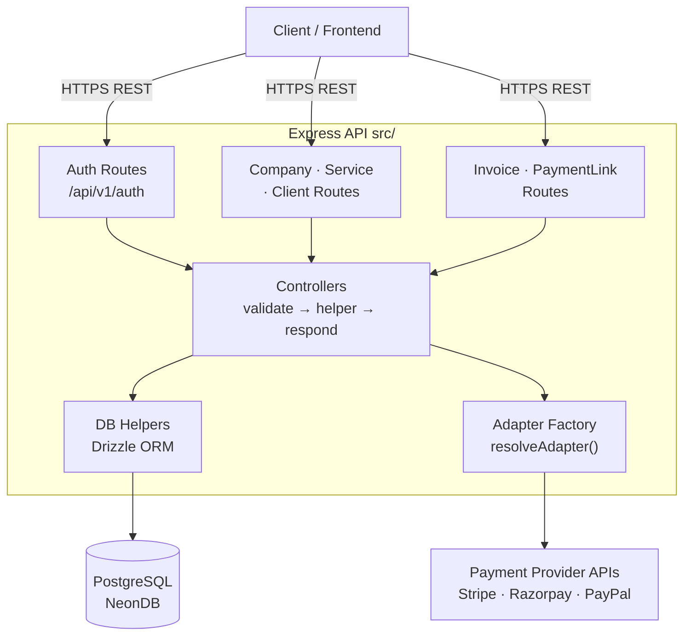
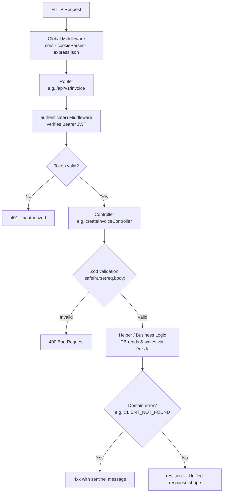
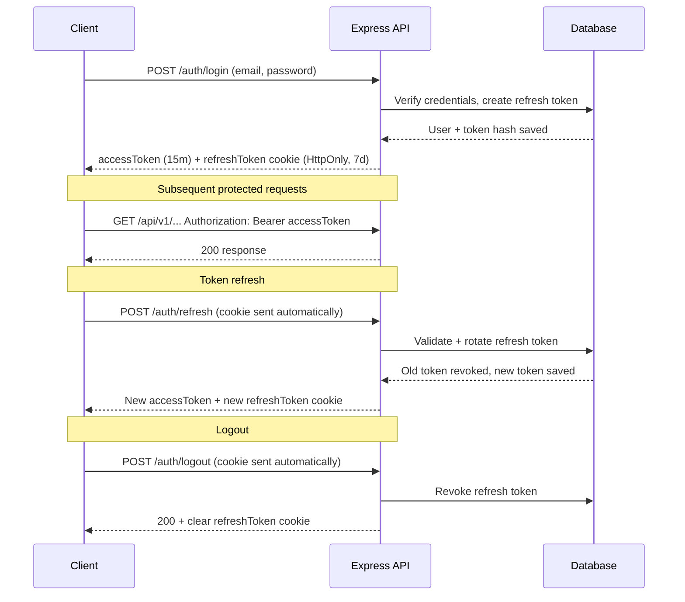
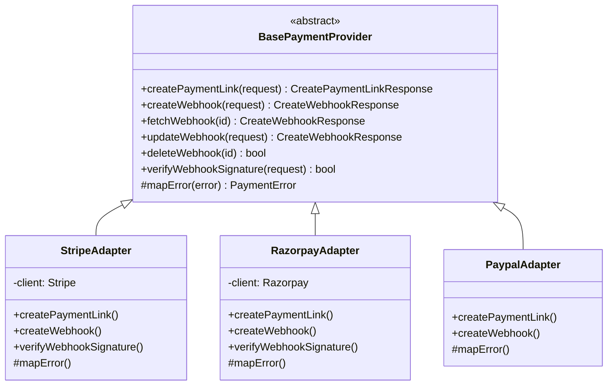
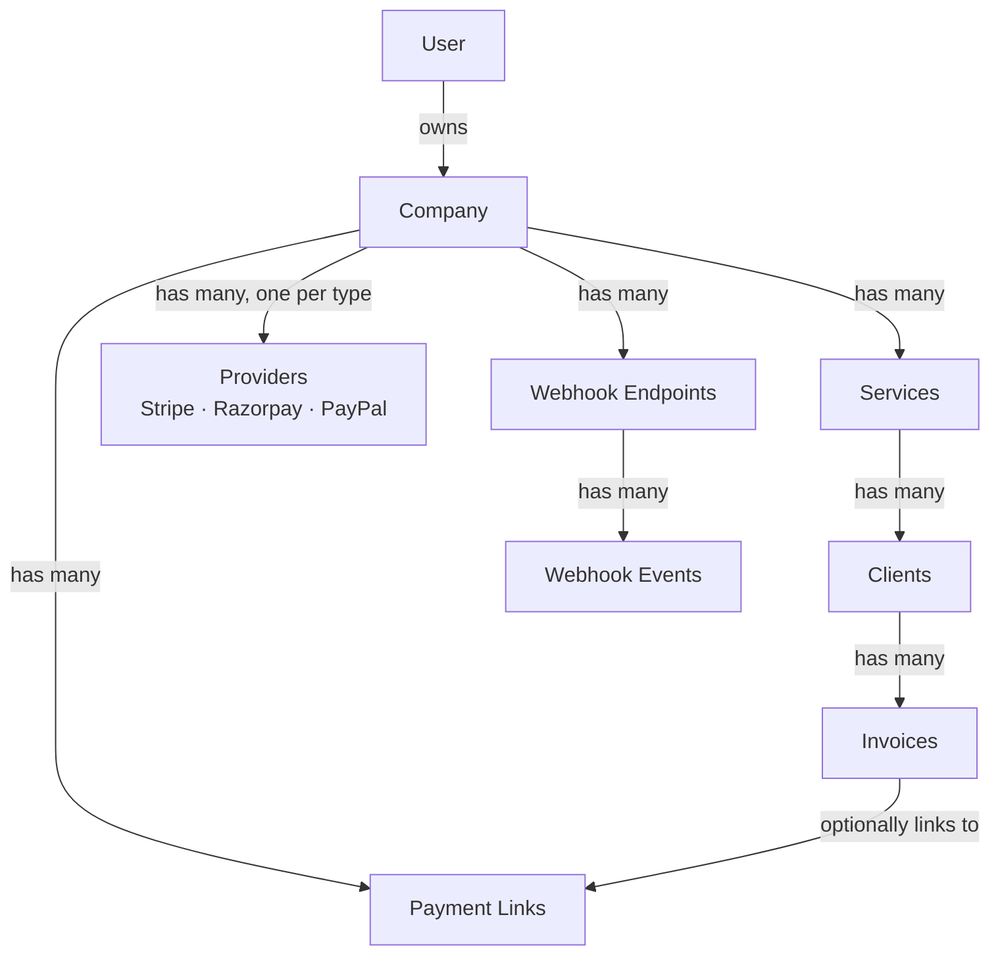
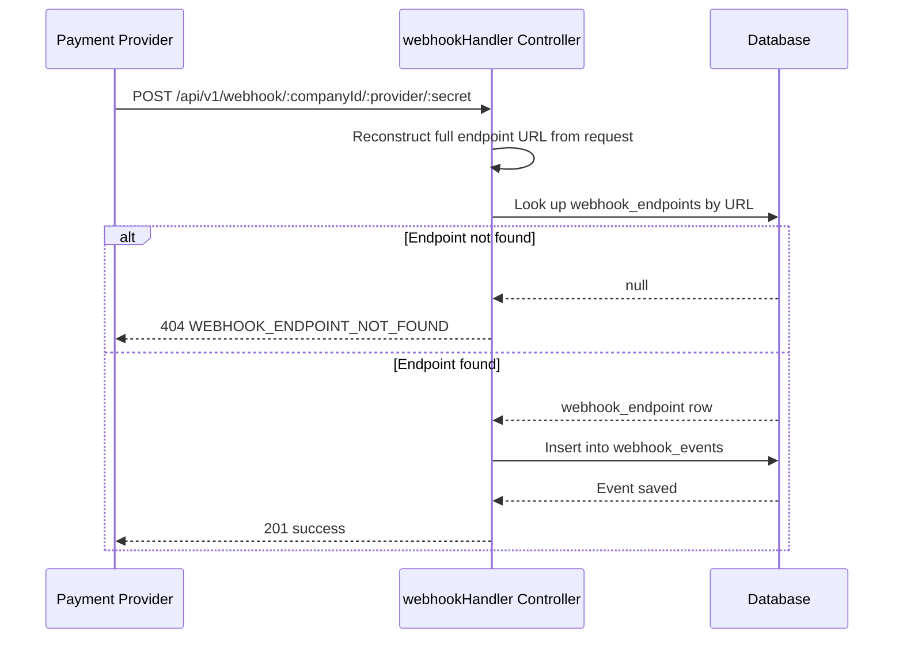
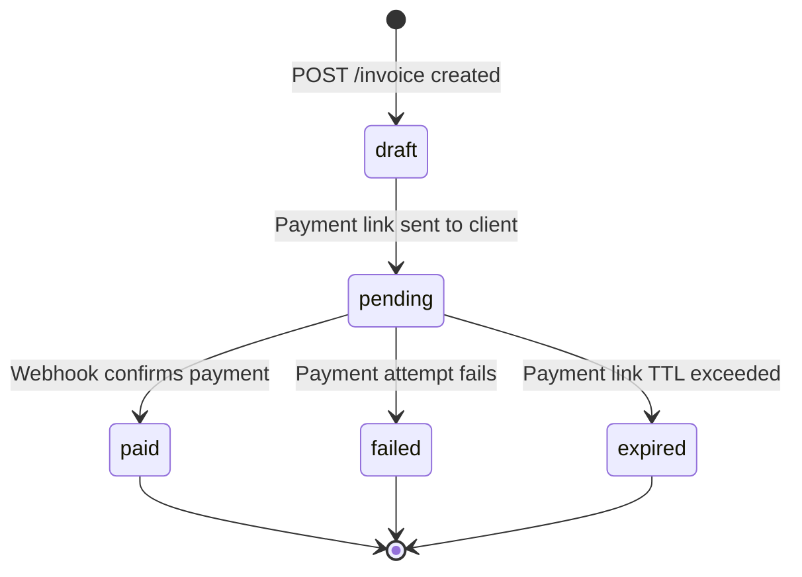

# System Design — Payment SDK

## Overview

The **Payment SDK** is a multi-tenant, provider-agnostic payment backend built with **Node.js / Express** and **TypeScript**. It abstracts over multiple payment gateways (Stripe, Razorpay, PayPal) behind a unified adapter interface, enabling companies to create payment links, manage invoices, register webhooks, and track payment events — all through a single REST API.

---

## Goals & Non-Goals

| Goal | Description |
|------|-------------|
| ✅ Provider abstraction | One API surface regardless of which gateway a company uses |
| ✅ Multi-tenancy | Each `Company` owns its own providers, services, clients, invoices, and webhooks |
| ✅ Invoice lifecycle | Draft → Pending → Paid / Failed / Expired with email notifications |
| ✅ Webhook ingestion | Accept and durably store inbound events from payment providers |
| ✅ JWT auth | Stateless access tokens + rotating refresh tokens stored in HttpOnly cookies |

| Non-Goal | Reason |
|----------|--------|
| ❌ Real-time dashboards | Out of scope; can be built on top with DB views |
| ❌ Billing / subscriptions | Future scope |
| ❌ Mobile SDKs | This is a server-side backend only |

---

## High-Level Architecture



---

## Module Breakdown

### `src/` — Application Layer

| File / Folder | Purpose |
|---------------|---------|
| `server.ts` | Entry point; starts HTTP server |
| `app.ts` | Express app setup — middleware, versioned routes, error handler |
| `swagger.ts` | Swagger document construction |
| `routes/` | Route definitions, apply `authenticate` middleware where required |
| `controllers/` | Request parsing (Zod), delegation to helpers, response shaping |
| `middlewares/auth.middleware.ts` | JWT verification + company resolution per request |
| `lib/adapter.factory.ts` | `resolveAdapter()` — looks up provider row and returns a typed adapter |
| `services/notification/` | Courier-powered email notifications |
| `services/logging/` | Winston logger (file + console transports) |

### `core/` — SDK Layer (Provider-Agnostic)

| File | Purpose |
|------|---------|
| `types.ts` | Shared DTOs: `CreatePaymentLinkRequest`, `CreateWebhookRequest`, etc. |
| `base.ts` | `BasePaymentProvider` abstract class + `PaymentError` |
| `adapters/stripe.adapter.ts` | Stripe implementation |
| `adapters/razorpay.adapter.ts` | Razorpay implementation |
| `adapters/paypal.adapter.ts` | PayPal implementation (placeholder) |

### `db/` — Data Access Layer

| File | Purpose |
|------|---------|
| `schema.ts` | Drizzle ORM table definitions |
| `relations.ts` | Relational mappings between tables |
| `index.ts` | Database client singleton (NeonDB / pg) |

### `configs/` & `utils/`

| File | Purpose |
|------|---------|
| `configs/config.ts` | Centralised env/config access |
| `utils/hashing.ts` | bcrypt + JWT sign/verify helpers |
| `utils/schema.ts` | Shared Zod schemas (User, Company input validation) |
| `utils/sdk.utils.ts` | Miscellaneous shared utilities |

---

## Request Lifecycle



---

## Authentication & Authorization

### Access Token Flow (JWT)



### Token Storage

| Token | Location | TTL |
|-------|----------|-----|
| Access token | Response body + `Authorization` header | 15 minutes |
| Refresh token | `HttpOnly` cookie + hashed in `refresh_tokens` table | 7 days |

### Role-Based Access

```
requireRole('admin')   → Guards admin-only routes
authenticate()         → Guards all business routes
```

Only `POST /api/v1/user` (registration) and `POST /api/v1/auth/login` are public.  
The webhook inbound handler (`POST /webhook/:companyId/:provider/:secret`) is also public — it's called by payment providers directly.

---

## Provider Adapter Pattern

The core of the SDK is a **strategy pattern** implemented via `BasePaymentProvider`:



`resolveAdapter(providerId, companyId?)` in `lib/adapter.factory.ts`:
1. Looks up the `providers` table by UUID or by `(type, companyId)` pair.
2. Decodes stored `credentials` JSON.
3. Instantiates the correct adapter class.
4. Returns `{ adapter, provider }`.

---

## Multi-Tenancy Model



- A **User** registers and owns exactly one **Company** in the current model.
- A **Company** can have multiple **Providers** (one per gateway type — enforced by a unique constraint).
- **Services** are the product/service offerings of the company. **Clients** are subscribed to a specific service.
- **Invoices** are tied to a client; they optionally link to a **PaymentLink**.
- **WebhookEndpoints** and **WebhookEvents** are company-scoped.

---

## Webhook Ingestion Flow



Signature verification is available via `verifyWebhookSignature()` on the adapter and can be layered in per-provider as needed.

---

## Invoice Lifecycle



| State | Trigger |
|-------|---------|
| `draft` | Created via `POST /invoice` |
| `pending` | Payment link generated and sent to client |
| `paid` | Webhook event from provider confirms payment |
| `failed` | Payment attempt fails |
| `expired` | Payment link TTL exceeded |

`POST /invoice/notify/:id` sends the invoice email to the client via **Courier**.

---

## Notification System

Powered by [`@trycourier/courier`](https://www.courier.com/). Email templates live in `src/services/notification/templates/`.

| Template | Trigger |
|----------|---------|
| `invoice.template.ts` | Invoice email sent to client |

The `NotificationService` persists delivery records in the `notifications` table with `status: pending | sent | failed`.

---

## Tech Stack

| Layer | Technology |
|-------|-----------|
| Runtime | Bun (dev), Node.js (prod) |
| Framework | Express 5 |
| Language | TypeScript 5 |
| Database | PostgreSQL via NeonDB serverless driver |
| ORM | Drizzle ORM |
| Migrations | drizzle-kit |
| Validation | Zod 4 |
| Auth | JWT (`jsonwebtoken`) + bcrypt |
| Payments | Stripe SDK, Razorpay SDK |
| Notifications | Courier (`@trycourier/courier`) + nodemailer |
| Logging | Winston |
| API Docs | Swagger UI Express |
| Testing | Vitest + Supertest |

---

## Directory Structure

```
payment-sdk/
├── core/                       # Provider-agnostic SDK layer
│   ├── base.ts                 # Abstract class + PaymentError
│   ├── types.ts                # Shared DTOs and enums
│   ├── index.ts                # Re-exports
│   └── adapters/
│       ├── stripe.adapter.ts
│       ├── razorpay.adapter.ts
│       └── paypal.adapter.ts
├── db/
│   ├── schema.ts               # Drizzle table definitions
│   ├── relations.ts            # Drizzle relation mappings
│   └── index.ts                # DB client
├── drizzle/                    # Generated migration SQL
├── src/
│   ├── app.ts                  # Express app + route mounting
│   ├── server.ts               # HTTP server bootstrap
│   ├── swagger.ts              # OpenAPI document
│   ├── controllers/            # Route handlers (one dir per domain)
│   ├── routes/                 # Express Router definitions
│   ├── middlewares/
│   │   └── auth.middleware.ts
│   ├── lib/
│   │   └── adapter.factory.ts
│   └── services/
│       ├── logging/
│       └── notification/
├── configs/
├── utils/
└── docs/
    ├── system-design.md        # ← this file
    ├── db.md
    └── api.md
```
